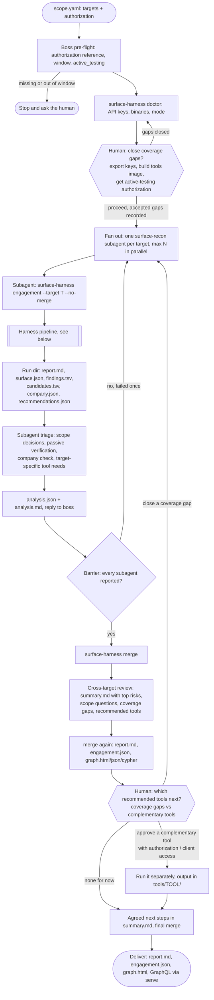
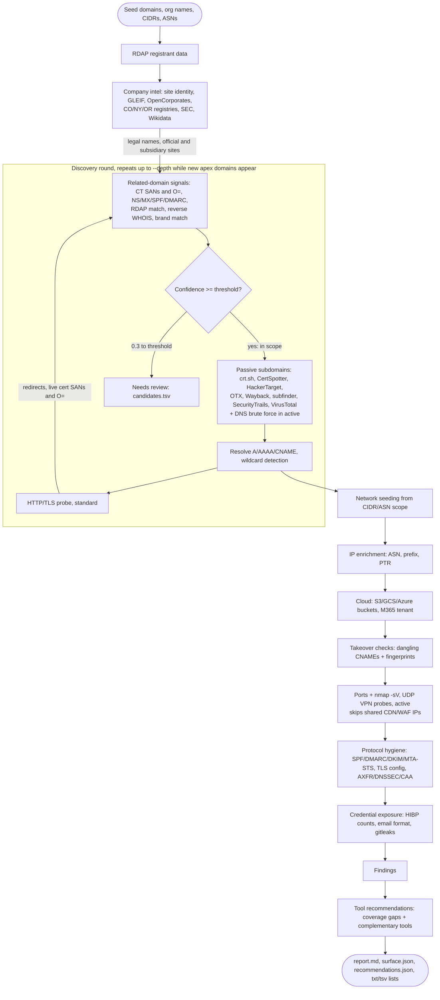

# surface-harness

Give it one or more seed domains. It finds the organisation's **other domains**, enumerates their
**subdomains**, resolves and fingerprints what's live, and writes a report of the external attack surface.

> Only run this against organisations you're authorised to assess. `passive` and `standard` modes
> generate roughly the traffic of normal browsing. `active` mode (DNS brute force and port scanning)
> refuses to run unless you pass `--authorized`, or unless the engagement scope sets
> `active_testing: true`.

**Contents:** [Flow](#flow) · [Engagements](#engagements-multiple-companies-per-contract) ·
[Agent orchestration](#agent-orchestration-boss--subagents) ·
[Output and JSON contract](#output-one-report--json-for-tools) ·
[Visualising and querying](#visualising-and-querying-graph--graphql) · [Pipeline](#pipeline) ·
[Tool recommendations](#tool-recommendations-completing-the-picture) ·
[Company information](#company-information) ·
[Tools and API keys](#tools-data-sources-and-api-keys) · [Running it](#running-it) ·
[Development and CI](#development-and-ci)

## Flow

The engagement, end to end. Rounded boxes are steps for the boss agent, subagents or harness;
hexagons are points where the agent **stops and asks you**. Nothing in a hexagon is decided by an
agent.



What a single harness run does (`scan`, or one target of `engagement`). Stages marked
*standard* or *active* only run in that mode or higher.



## Engagements (multiple companies per contract)

Each client contract is one **engagement**: a directory with a `scope.yaml` that lists the
companies (targets) to assess and records the authorization. Client data stays inside its own
directory. `engagements/` is git-ignored, and engagements are never merged together.

```bash
.venv/bin/surface-harness init engagements/acme-2026q4 --client "Acme Holdings"   # writes scope.yaml
$EDITOR engagements/acme-2026q4/scope.yaml                                       # targets + authorization
.venv/bin/surface-harness engagement engagements/acme-2026q4 --parallel 3        # run all targets, then merge
.venv/bin/surface-harness engagement engagements/acme-2026q4 --target acme-eu    # re-run one target
.venv/bin/surface-harness merge engagements/acme-2026q4                          # rebuild report/JSON/graph
```

```yaml
engagement: acme-2026q4
client: "Acme Holdings"
authorization:
  reference: "SOW-1234 signed 2026-11-01"   # required
  window: "2026-11-10 to 2026-11-24"
  active_testing: false                      # must be true for --mode active
defaults: {mode: standard, depth: 1, threshold: 0.7, max_apexes: 25}
exclude: [zendesk-hosted-thing.com]          # applies to every target
targets:
  - id: acme            # lowercase slug
    name: "Acme Inc."
    domains: [acme.com, acme.io]
    org: ["Acme Inc."]
    networks: [203.0.113.0/24]   # optional in-scope IP ranges (CIDRs), expanded to host IPs
    asns: [AS64500]              # optional in-scope ASNs; prefixes fetched passively via RIPEstat
  - id: acme-eu
    name: "Acme Europe GmbH"
    domains: [acme.eu]
    org: ["Acme Europe GmbH"]
    mode: passive        # per-target overrides: mode, depth, threshold, exclude
```

`examples/scope.example.yaml` is the scope used during development (hackerone.com and
harvestrangelabs.com).

```
engagements/<id>/
  scope.yaml
  latest -> <YYYYMMDD-HHMMSS>            symlink to the newest run
  <YYYYMMDD-HHMMSS>/                     ONE directory per engagement run, never reused
    scope.yaml                           the scope as it was for this run
    targets/<target>/runs/<timestamp>/   harness output (report.md, surface.json, ...)
    targets/<target>/analysis.json|.md   analyst output (subagents), optional
    summary.md                           executive summary (boss agent), optional
    report.html                          work queue: what to do about each finding
    report.md                            ONE consolidated report
    engagement.json                      ONE machine-readable document (versioned schema)
    graph.json | graph.cypher | graph.html
```

**Runs never overwrite each other.** `surface-harness engagement <dir>` starts a new dated run
directory every time; the harness output, the analysts' files, the summary and the merged
reports of that run all live inside it. To run targets separately into one run (what the agents
do), create it first and pass the run directory instead of the engagement directory:

```bash
RUN=$(surface-harness new-run engagements/acme)        # engagements/acme/20261116-170500
surface-harness engagement "$RUN" --target acme-us --no-merge
surface-harness engagement "$RUN" --target acme-eu --no-merge
surface-harness merge "$RUN"                           # or: merge engagements/acme  (= latest run)
```

`merge` and `serve` given the engagement directory use the latest run; given a run directory
they use that run, with the `scope.yaml` stored in it. Engagements created before this layout
(with `targets/` directly in the engagement directory) still merge in place.

## Agent orchestration (boss + subagents)

The repo ships two Claude Code pieces:

- `.claude/agents/surface-recon.md`: the **subagent**. It runs the harness for one target,
  decides scope for candidate domains, verifies findings passively, and writes
  `<run>/targets/<id>/analysis.json` and `analysis.md`.
- `.claude/commands/engagement.md`: the **boss**, available as the slash command
  `/engagement engagements/<id> [mode] [max-parallel]`.

The boss checks the environment with `surface-harness doctor` and **asks you** which coverage
gaps to close before it starts (it never handles key values or edits the authorization). It then
sends one subagent per target in parallel, waits for all of them to finish (a barrier), merges,
writes the executive summary, and merges again. Finally it **asks you** which recommended tools
to pursue next and records the answer in `summary.md`. Subagents can't ask you anything: they
pass target-specific tool needs to the boss through `analysis.json → tool_recommendations`. Restart Claude Code after cloning so the
agent and command are picked up.

### Template prompt

Use this when you don't want the slash command, or to adapt it in another orchestrator. Replace
the `{{...}}` placeholders.

```text
You are the engagement lead (boss agent) for an authorised external attack-surface assessment.

ENGAGEMENT DIR: {{engagements/<id>}}
MODE OVERRIDE:  {{none | passive | standard | active}}
MAX PARALLEL:   {{4}}

1. Pre-flight. Read {{dir}}/scope.yaml. Stop and ask me if authorization.reference is missing,
   if today is outside authorization.window, or if active mode is requested without
   authorization.active_testing: true. Check that `.venv/bin/surface-harness --help` works (or
   that the surface-harness:latest Docker image exists). List the targets. Run
   `.venv/bin/surface-harness doctor {{dir}} --json`; if it reports coverage_gaps, show them and
   ask me which to close (keys are exported by me, never pasted into chat; only I change
   authorization). Record the gaps I accept.

2. Fan out. Create this run's directory with `.venv/bin/surface-harness new-run {{dir}}` (it
   prints {{run}} = {{dir}}/<YYYYMMDD-HHMMSS>; all output of this run goes under it). For each
   target, dispatch a `surface-recon` subagent with: the engagement dir, {{run}}, the target id
   and the mode override. Send all dispatches of a batch in ONE message so they run in
   parallel, at most MAX PARALLEL per batch.

3. Barrier. Wait until EVERY subagent has reported back before continuing (and between batches).
   Never merge or summarise partial results. Re-dispatch a failed target once, then record it
   as failed. A target with status `killed` hit the third-party kill-switch: never re-dispatch
   it or edit scope.yaml to get past it; show me the reason and ask.

4. Merge: `.venv/bin/surface-harness merge {{run}}`. If it prints analysis warnings, fix that
   target's analysis.json to match the schema (or re-dispatch its agent), then merge again.

5. Cross-target review. Read {{run}}/engagement.json and write {{run}}/summary.md, starting with
   "# Executive summary". Cover: scope and method; the top risks across all targets, ranked,
   with target ids; scope questions for the client (all needs-client-confirmation decisions,
   and the third-party domains the kill-switch held back);
   meaningful overlaps between targets (not CDNs); coverage gaps (missing API keys, failed
   targets, errored sources); "## Recommended tools" from engagement.json tool_recommendations
   (high and medium, one line each: tool, targets, why, what it needs).

6. Merge once more. Ask me which recommended tools to pursue next. Don't run a tool outside the
   harness unless I approve it and the authorization covers it. Record my choices under
   "## Agreed next steps" in summary.md, merge again, then reply with the paths to report.html,
   report.md, engagement.json and graph.html, plus a 5-line summary.

Rules: you coordinate and the subagents scan. Stay within scope.yaml and its exclude lists. No
exploitation, logins, fuzzing or brute force. Never pivot on registered agents or WHOIS privacy
proxies. Never send anything to a third party (customers, tenants, vendors). Keep all output
inside this run's directory.
```

Each subagent's prompt from the boss only needs the variable parts, for example: *"Engagement
dir: engagements/acme-2026q4. Run dir: engagements/acme-2026q4/20261116-170500. Target id:
acme-eu. Mode override: none."* The rules, steps and
`analysis.json` schema live in `.claude/agents/surface-recon.md`.

Without agents, `surface-harness engagement <dir> --parallel N` runs every target concurrently
in one process and merges. You get the same report, minus the analyst triage.

## Output: one report + JSON for tools

`surface-harness merge` (run automatically after `engagement`) takes the **latest complete run**
of each target inside one engagement run directory, plus `analysis.json`/`analysis.md` and
`summary.md` when present, and writes into that run directory:

- **`report.html`**: the findings as a **work queue**, in one self-contained file (no network
  access, opens from disk). Use it to act on the results:
  - *Work queue*: every analyst-triaged finding with **what to do**, the evidence, a state
    (to do / in progress / fixed / risk accepted / not an issue), an owner and notes. "Copy as
    ticket" produces Markdown for Jira/GitHub; the whole queue exports as Markdown or CSV.
    State is kept in the browser, keyed to the engagement and finding, so it carries over to
    the report of the next run; export/import it as JSON to share it.
  - *Decisions*: scope questions for the client (copy as an email, or as a `scope.yaml`
    line), and the third-party domains the kill-switch refused to touch.
  - *Raw findings*: all harness findings grouped by kind, each with its standard fix and the
    affected assets ready to copy into one ticket or a script.
  - *Next steps*: recommended tools, what each needs and the command that enables it.

- **`report.md`**: one document for the client. It contains the engagement header and
  authorization, the executive summary, a targets overview, a single findings table across all
  targets (analyst-validated and raw harness findings), cross-target overlap, **recommended tools
  for a complete picture**, and then a section
  per target (analyst notes, scope decisions, company records, findings, domains, live hosts,
  networks).
- **`engagement.json`**: the same content as one versioned document for downstream tools:

```jsonc
{
  "schema": "surface-harness/engagement", "schema_version": "1.0", "generated_at": "...",
  "engagement": { "id", "client", "authorization", "defaults", "exclude" },
  "summary_md": "...",                       // boss agent's executive summary
  "targets": [{
    "id", "name", "domains", "org", "status",  // status: complete | interrupted | failed | missing
    "run_dir", "meta",                       // run timing, config, harness version, API keys present
    "summary": { "in_scope_domains", "candidate_domains", "hosts", "live_hosts",
                 "web_services", "ips", "findings": {"high": 1}, "legal_entities" },
    "analysis": { ...analysis.json... }, "analysis_warnings": [],
    "surface": {                             // full run (schema "surface-harness/run" 1.0)
      "domains": { "<apex>": { "confidence", "seed", "evidence": [...], "whois": {...} } },
      "hosts":   { "<fqdn>": { "a", "aaaa", "cnames", "open_ports", "http": [...], "tls": [...] } },
      "ips":     { "<ip>": { "asn", "as_name", "prefix", "ptr", "hosts" } },
      "companies": [ { "source", "name", "jurisdiction", "agent_name", "agent_commercial",
                       "officers", "parents", "subsidiaries", ... } ],
      "site_identity": { ... }, "findings": [ ... ], "org_names": [ ... ],
      "email_security": { "<apex>": {...} }, "dns_hygiene": { "<apex>": {...} },
      "tls_config": [...], "cloud_assets": [...], "m365_tenants": [...],
      "breaches": [...], "email_formats": [...]
    }
  }],
  "tool_recommendations": [{                 // since 1.1, see "Tool recommendations"
    "id", "name", "kind", "priority", "area", "adds", "needs", "enable", "url", "reasons", "targets"
  }],
  "cross_target": { "shared_domains", "shared_ips", "shared_asns" }
}
```

Schemas are versioned (`schema_version`). Fields may be added within 1.x; renames or removals
bump the major version, so importers can check the version and fail loudly.

## Visualising and querying (graph + GraphQL)

`merge` also turns the engagement into a graph. Node types: `Engagement`, `Target`,
`LegalEntity`, `RegisteredAgent`, `Officer`, `Organisation`, `Profile`, `Domain`, `Host`, `IP`,
`ASN`, `Finding`. Edge types: `OWNS`, `CANDIDATE`, `HAS_HOST`, `RESOLVES_TO`, `IN_ASN`, `CNAME`,
`HAS_ENTITY`, `REGISTERED_AGENT`, `OFFICER_OF`, `SUBSIDIARY_OF`, `AFFECTS`. Node ids are stable
(e.g. `ip:1.2.3.4`), so an asset shared by two targets is one node tagged with both.

| Output | Use it for |
|---|---|
| `graph.html` | Open in a browser: an interactive Cytoscape view with filters by type and target, search, and click-to-inspect. Dragging a node brings its branch with it (Target → domains → hosts → findings; shared nodes such as a CDN IP stay put). The drag selector also offers *direct neighbours*, *live physics* (springs via cola) and *single node*, plus Re-layout and Fit buttons. IPs are hidden by default when there are more than 100 (CDN noise). |
| `graph.cypher` | `cypher-shell -f graph.cypher` loads it into **Neo4j**, which is the best fit for exploring relationships across many engagements (Neo4j Browser/Bloom). |
| `graph.json` | Generic `{nodes, edges}` for D3, Gephi or your own UI. |

**GraphQL** (`pip install -e '.[graphql]'`, included in the Docker image):

```bash
.venv/bin/surface-harness serve engagements/acme-2026q4       # http://127.0.0.1:8787/graphql  (GraphiQL UI)
```

```graphql
{
  engagement { client authorization }
  targets {
    id status summary
    entities { name source jurisdiction agentName agentCommercial officers { name role } }
    findings(minSeverity: "medium") { origin severity status detail target }
  }
  emailAuth: findings(kind: "email-spf") { targetId severity target detail }
  hosts(tech: "jenkins", live: true) { targetId name http { url status title } }
  domains(inScopeOnly: true) { targetId name confidence evidence { signal detail } }
  ips(asn: "13335") { ip hosts openPorts }
  ports(product: "nginx") { targetId ip port service product version cpe detection hosts }
                            # also: port: 6379, service: "redis", ip:, host:, targetId:
  emailSecurity { domain spfAll dmarcPolicy dmarcPct dkimSelectors mtaSts tlsRpt }
  dnsHygiene { domain axfr dnssec caa danglingNs nameservers }
  tlsConfig(weakOnly: true) { host port weakProtocols hsts expiresInDays }
  cloudAssets(provider: "s3") { name provider state url }
  m365Tenants { domain tenantId namespace federationHost federationBrand }
  toolRecommendations(minPriority: "medium") { priority name kind needs enable targets reasons }
                            # also: kind: "coverage-gap" | "complementary" | "analyst", targetId:
  breaches { domain accounts breachCount breaches { name year accounts } }
  emailFormats { domain format template samples considered }
  graph   # same as graph.json
}
```

The structured posture objects above carry the same data as the `email-*`, `tls-*`, `dns-*`,
`cloud-bucket`, `m365-*` and `breach-exposure` findings, but as typed, filterable fields (e.g.
`tlsConfig(weakOnly: true)`, `cloudAssets(provider: ...)`, or `emailSecurity { dmarcPolicy }` to
list domains by DMARC posture). Each also appears as a top-level key in `engagement.json`'s
`surface` object. `findings(kind: ...)` remains the way to get the human-readable detail string.

Open ports (active mode) are recorded per IP, together with `nmap -sV --version-light` results
(service, product, version, extra info, CPEs, and `detection`: `probed` = fingerprint match,
`table` = guessed from the port number). They are in `surface.json → ips.<ip>.services`, the
"Open ports and services" table in each report, the `Port` graph nodes, and the GraphQL `ports` query. Scans run per host, so `ports` merges every host
name that resolves to the IP into `hosts`, plus any HTTP service seen on that port in `web`.
In `graph.html` they show up as teal `Port` nodes under their IP (`IP -HAS_PORT-> Port`), and
findings about an `ip:port` attach to the port node.

The server reads `engagement.json` again whenever it changes, and binds to localhost by default
because the data is client-confidential.

## Pipeline

```
seeds ─► RDAP registrant data
  └─► company intel: website identity (schema.org, legal-entity text, security.txt) ─► GLEIF,
      OpenCorporates, CO/NY/OR state registries, SEC, Wikidata ─► legal names, agents, officers,
      parent/subsidiaries (legal names + official/subsidiary sites feed back into discovery)
  └─► round N (repeats up to --depth while new in-scope apex domains appear)
        passive subdomain sources ─┐   crt.sh, CertSpotter, HackerTarget, OTX, Wayback,
        (+ DNS brute in active)    │   subfinder (Docker), SecurityTrails/VirusTotal with keys
        related-domain signals ────┤   CT SAN co-occurrence, CT search by cert O=, NS/MX/SPF/DMARC,
                                   │   RDAP registrant match, reverse WHOIS (key), brand-name match
        resolve (A/AAAA/CNAME, wildcard detection)
        HTTP/TLS probe ────────────┘   redirects, live cert SANs, cert O= → fed back as evidence
  └─► network seeding (CIDR/ASN scope input → host IPs, capped; ASN prefixes via RIPEstat)
  └─► IP enrichment (ASN/prefix/PTR via Team Cymru DNS)
  └─► cloud recon (S3/GCS/Azure bucket existence; Microsoft 365 tenant/federation)
  └─► takeover checks (dangling CNAMEs + service fingerprints)
  └─► port scan + nmap -sV on open ports, UDP VPN probes (active; skips shared CDN/WAF IPs)
  └─► protocol hygiene (email auth SPF/DMARC/DKIM/MTA-STS, TLS config, DNS AXFR/DNSSEC/CAA)
  └─► credential exposure (HIBP breach counts, email-format, gitleaks public-repo secrets)
  └─► findings + report
  └─► tool recommendations (coverage gaps + complementary tools, see below)
```

### How related domains are scored

Each candidate domain collects weighted evidence. Each signal type counts once, at its strongest
weight, and the combined confidence is `1 − ∏(1 − w)`. Domains at or above `--threshold`
(default 0.7) are treated as in scope and enumerated themselves. Domains between 0.3 and the
threshold go to **"needs review"** in the report, so a person makes the scope call.

| Signal | Weight | | Signal | Weight |
|---|---|---|---|---|
| RDAP registrant email match | 0.70 | | shares a TLS cert (CT or live) | 0.50 |
| RDAP registrant org match | 0.60 | | brand-stem match (`acme` → `acme-cloud.io`) | 0.40 |
| cert issued to `O=<org>` | 0.60 | | NS of an in-scope domain | 0.25 |
| in-scope site redirects to it | 0.60 | | MX/SPF/DMARC, or linked from homepage | 0.15 |
| reverse WHOIS hit | 0.60 | | contact email domain on seed site | 0.45 |
| official website of matched entity | 0.80 | | parent/owner's website | 0.50 |
| subsidiary's website | 0.60 | | schema.org `sameAs` on seed site | 0.60 |

Large shared providers (Google, Microsoft, AWS, Cloudflare, mail and DMARC vendors, and so on) are
filtered out. Certificates covering more than 40 apex domains are ignored as shared hosting.

### Third-party kill-switch

The harness must never send traffic to someone who did not authorise it: the client's
customers, tenants on the client's platform, vendors, SSO providers. Four layers enforce that,
and none can be switched off:

1. **Ownership evidence is required.** Only these signals say "the organisation owns this
   domain": registrant org/email match, cert issued to `O=<org>`, reverse WHOIS, brand-stem
   match, official/subsidiary website of the matched entity. Redirects, shared certificates,
   links, NS/MX/SPF, `sameAs` and contact-email domains are *association* signals: they raise a
   candidate for review, but a domain with association evidence only is capped at 0.45 and can
   never be in scope, however many signals stack up. The threshold cannot be set at or below
   that cap. (On a hosting platform, a tenant that redirects to its owner's SSO and presents
   its owner's certificate would otherwise score 0.8.) A live certificate also only counts
   when it actually covers the host that presented it.
2. **Registrant veto.** A candidate whose registration names a different, unrelated
   organisation is marked third-party and capped at 0.2, whatever else points at it.
3. **Nothing is contacted before it is cleared.** A discovered domain is resolved, probed or
   enumerated only once it has ownership evidence, is above the threshold, is not excluded, and
   has had its registration checked. Redirects are followed hop by hop and **not followed out
   of scope**: the target is recorded as evidence (`offscope_redirect`) and never requested.
   `urls.txt` lists in-scope URLs only, so nothing third-party is handed to other tools.
4. **Tripwire.** Immediately before every DNS, TLS or HTTP request the host is checked again.
   If an uncleared host ever gets that far, the run stops at once: `meta.status` is `killed`,
   `meta.kill_switch.reason` says which host and why, the CLI exits with code 3, and the reports
   carry a KILL-SWITCH banner. The agents are told not to retry or work around it.

What was held back is listed under **"Third-party domains not touched"** in the run's
`report.md`, in `surface.json → meta.third_party_blocked`, and on the *Decisions* tab of
`report.html`. Seeds are always in scope because you declared them: to authorise a held-back
domain, add it to the target's `domains` in `scope.yaml`. Note that a seed which is a
multi-tenant platform domain is enumerated and probed host by host, including hosts that
belong to tenants; use `exclude` (or leave the domain out) if tenants are not authorised.

## Tool recommendations: completing the picture

The harness covers ownership-based domain discovery, DNS, web/TLS fingerprinting and passive
exposure checks. Every run report ends with **Recommended tools for a complete picture**, and the
engagement report consolidates them across targets (also `recommendations.json` per run,
`engagement.json → tool_recommendations`, and the GraphQL `toolRecommendations` query). Nothing in
that list is run automatically.

- **Coverage gaps** are integrations the harness already has but couldn't use in this run: a
  missing API key (WhoisXML, SecurityTrails, OpenCorporates, HIBP, ...), a missing binary
  (subfinder, naabu/nmap, local gitleaks), `SURFACE_CONTACT` unset, or a mode that wasn't run
  (passive → standard, no active-testing authorization). Close the gap, then re-run.
- **Complementary tools** cover the parts of the external surface outside the harness, and are
  recommended only when the run found something that calls for them:

| Tool | Area | Recommended when | Needs |
|---|---|---|---|
| Shodan / Censys | Network services | IPs found; high priority when no port scan ran | API key |
| gowitness / EyeWitness | Web applications | live web services | binary |
| nuclei | Vulnerabilities | live web services | written authorization |
| testssl.sh | TLS | TLS endpoints; medium when weak protocols seen | binary |
| katana | Web applications | live web services (JS endpoints) | authorization for crawling |
| dnstwist | Brand / phishing | always (lookalike domains) | binary |
| GitHub/GitLab org search + trufflehog | Code / secrets | always; medium when repos or secrets found | GitHub token |
| Prowler / ScoutSuite | Cloud | cloud buckets or IPs in cloud-provider ASNs | client read-only credentials |
| Maester / CISA ScubaGear | Identity | Microsoft 365 tenant found | client read-only tenant access |
| Burp Suite / OWASP ZAP | Web applications | exposed login portals or admin services | written authorization |
| App-store search + MobSF | Mobile | always (low) | none for search |

Analysts can add target-specific recommendations in `analysis.json → tool_recommendations`
(`tool`, `priority`, `reason`, optional `needs`); they merge into the same list, tagged with the
target. Check an environment before a run with:

```bash
.venv/bin/surface-harness doctor engagements/acme-2026q4      # uses the scope's modes + authorization
.venv/bin/surface-harness doctor --mode active --json          # machine-readable, used by the boss agent
```

## Company information

The company stage identifies the legal entity behind the seed domains. It records the entity's
jurisdiction, registration number, status, formation date, registered/principal/mailing addresses,
**registered agent**, officers, LEI, former names, parent and subsidiaries. These go in the report's
**Company** section and in `company.json`.

| Source | Needs | Notes |
|---|---|---|
| Seed website | standard/active mode | schema.org Organization, copyright/legal-entity text, emails, phones, `sameAs`, security.txt |
| GLEIF (LEI) | nothing | legal + HQ address, registration authority, direct/ultimate parent, children |
| Colorado / New York / Oregon open data | nothing | registered agent, principal/mailing address, officers (OR), foreign registrations |
| OpenCorporates | `OPENCORPORATES_API_TOKEN` | broadest coverage (all US states incl. WY/DE, 140+ jurisdictions), agents, officers |
| Wikidata | `SURFACE_CONTACT` | looked up by official website; parent/subsidiaries **with their websites** |
| SEC EDGAR | `SURFACE_CONTACT` or `SEC_USER_AGENT` | public companies: CIK, EIN, addresses, former names |

`SURFACE_CONTACT` is an email address or URL. Wikimedia and the SEC require contact details in the
User-Agent, so without it those two sources are skipped.

**Registered agents and mail drops.** Many companies file with a commercial registered agent
(Northwest Registered Agent / Registered Agents Inc, CT Corporation, CSC, Business Filings Inc,
and so on), and some list a PMB or PO box as their address. The harness flags these, including
when a "principal" address is really the agent's office. It never uses an agent's name or address
as a pivot: one agent fronts thousands of unrelated companies, so pivoting on it would pull
strangers into scope. The same applies to privacy-proxy WHOIS registrants.

Registry matches use exact names after removing suffixes (`Harvest Range Labs, LLC` = `HARVEST
RANGE LABS LLC`). Confirmed legal names (including former names) are added to the certificate
O= search. `--pivot-subsidiaries` also searches certificates issued to subsidiaries' names.

## Tools, data sources and API keys

Everything below works out of the box unless the **Key** column says otherwise. Missing keys never
stop a run: that source is skipped and the run's log, and the engagement summary's coverage gaps,
say so. Check what a run had in `surface.json → meta.config.api_keys_present`.

### Binaries (built into the `surface-tools` Docker image)

| Tool | Version | Used for | Mode | Key | Fallback if unavailable |
|---|---|---|---|---|---|
| [subfinder](https://github.com/projectdiscovery/subfinder) | v2.17.0 | Passive subdomain enumeration across dozens of aggregators | all | Optional, in its own config (see below) | Skipped; the built-in HTTP sources still run |
| [naabu](https://github.com/projectdiscovery/naabu) | v2.7.0 | TCP port discovery on non-CDN IPs | active | none | Built-in asyncio connect() scanner |
| [nmap](https://nmap.org) | Debian bookworm | `-sV --version-light` on ports naabu found (service, product, version, CPE) | active | none | Ports are kept; service names are guessed from the port number |
| [dnsx](https://github.com/projectdiscovery/dnsx), [httpx](https://github.com/projectdiscovery/httpx) | v1.3.1, v1.12.0 | In the image for manual follow-up. The pipeline does DNS and HTTP in Python (see below) | n/a | none | n/a |

Each binary runs locally if it's on `PATH`, otherwise via `docker run --rm surface-tools <tool>`
(`--tools auto|local|docker|none`).

### Built-in (Python) stages

| Stage | Library / service | Mode | Key |
|---|---|---|---|
| DNS resolution, wildcard detection, NS/MX/SPF/DMARC, brute force (`-w`) | dnspython against your resolvers (`--resolvers`) | all; brute force is active only | none |
| IP → ASN / prefix / country | [Team Cymru](https://www.team-cymru.com/ip-asn-mapping) DNS (`origin.asn.cymru.com`) | all | none |
| HTTP probing (status, title, server, tech, redirects) | httpx (Python) | standard, active | none |
| TLS certificate grab (SANs, issuer, O=, validity) | Python `ssl` + cryptography | standard, active | none |
| TLS config audit (SSLv3/TLS1.0/1.1 support, cert expiry, missing HSTS) | per-version `ssl` handshakes | standard, active | none |
| Email-auth grading (SPF `+all`/lookup count, DMARC `p=`, DKIM selectors, MTA-STS/TLS-RPT) | dnspython TXT lookups | all | none |
| DNS hygiene (AXFR zone transfer, DNSSEC, CAA, dangling NS) | dnspython | all | none |
| Subdomain takeover checks | built-in CNAME/service fingerprints | all (fingerprints need standard) | none |
| Remote-access detection (VPN/RDP/Citrix/admin ports, product fingerprints, known login-path GETs) | built-in fingerprints + httpx | ports: active; fingerprints/paths: standard | none |
| UDP VPN probes (IKE/IPsec, IKE-NATT, OpenVPN, WireGuard) | single-packet asyncio datagram probes | active | none |
| Network seeding from CIDR/ASN input | `ipaddress` expansion (capped) + [RIPEstat](https://stat.ripe.net) ASN→prefixes | all | none |
| Cloud-asset discovery (S3/GCS/Azure bucket existence, Microsoft 365 tenant/federation) | passive HTTP to provider endpoints | buckets: standard, active; M365: all | none |
| Credential exposure (breach counts, email-format inference, public-repo secrets) | [HIBP](https://haveibeenpwned.com) + optional `gitleaks` | standard, active | `HIBP_API_KEY` (HIBP only) |
| Registrable-domain parsing | tldextract with an offline Public Suffix List | all | none |

### Passive subdomain sources (HTTP APIs)

| Source | Used for | Key | Env var | Notes |
|---|---|---|---|---|
| [crt.sh](https://crt.sh) | Certificate Transparency names; also the CT search by cert `O=<org>` | none | | Often slow or 502s under load; retried, and failures are logged |
| [CertSpotter](https://sslmate.com/certspotter/api/) | Certificate Transparency names | optional | `CERTSPOTTER_API_KEY` | Works without a key at a low hourly limit |
| [HackerTarget](https://hackertarget.com/find-dns-host-records/) | Passive DNS host search | none | | Free tier has a small daily quota per IP |
| [AlienVault OTX](https://otx.alienvault.com) | Passive DNS | optional | `OTX_API_KEY` | Works without a key but quickly returns HTTP 429; a free account key fixes that |
| [Wayback Machine CDX](https://web.archive.org) | Historic URLs → hostnames | none | | |
| [SecurityTrails](https://securitytrails.com) | Subdomain list | **required** | `SECURITYTRAILS_API_KEY` | Skipped without a key; small free tier |
| [VirusTotal](https://www.virustotal.com) | Observed subdomains | **required** | `VIRUSTOTAL_API_KEY` | Skipped without a key; free public API is rate-limited |
| subfinder providers | Extra aggregators (Shodan, Censys, Chaos, BinaryEdge, …) | optional | `~/.config/subfinder/provider-config.yaml` | Mounted read-only into the container when present. Start from `examples/provider-config.example.yaml` |

### Related-domain and ownership sources

| Source | Used for | Key | Env var |
|---|---|---|---|
| [rdap.org](https://rdap.org) | Registrant org/email (RDAP), used for scoring. Privacy proxies are ignored | none | |
| [WhoisXML Reverse WHOIS](https://reverse-whois.whoisxmlapi.com) | Other domains registered by the same org or email: the best way to find unrelated-looking domains | **required** | `WHOISXML_API_KEY` |
| crt.sh `O=` search | Certificates issued to the legal name (`--org`, or names confirmed by the registries) | none | |

### Company / legal-entity sources

| Source | Used for | Key | Env var |
|---|---|---|---|
| Seed website | schema.org Organization, legal-entity/copyright text, `sameAs`, security.txt | none (standard/active mode) | |
| [GLEIF](https://www.gleif.org) | LEI records, legal/HQ address, parent and children | none | |
| Colorado / New York / Oregon open data (Socrata) | Registered agent, addresses, officers (OR), foreign registrations | none | |
| [OpenCorporates](https://api.opencorporates.com) | All US states and 140+ jurisdictions, agents, officers | **required** | `OPENCORPORATES_API_TOKEN` |
| [SEC EDGAR](https://www.sec.gov/edgar) | Public companies: CIK, EIN, addresses, former names | **contact required** | `SURFACE_CONTACT` or `SEC_USER_AGENT` |
| [Wikidata](https://www.wikidata.org) | Entity by official website, with parent/subsidiaries and their websites | **contact required** | `SURFACE_CONTACT` |

### Credential exposure (passive, standard mode and above)

Read-only reporting for the client report: no authentication, password guessing or user enumeration.
Only aggregate exposure metadata is ever recorded - never a password, hash or secret value.

| Source | Used for | Key | Env var |
|---|---|---|---|
| [Have I Been Pwned](https://haveibeenpwned.com/api/v3) | Breach-by-domain **counts**: exposed accounts per breach, breach names and dates (finding `breach-exposure`) | **required** | `HIBP_API_KEY` |
| Pipeline-collected contacts | Likely corporate email format, e.g. `{first}.{last}@domain`, inferred from seed-site / security.txt emails (finding `email-format`) | none | |
| [gitleaks](https://github.com/gitleaks/gitleaks) | Secret counts, rule types and file paths in the org's already-known public repos (finding `secret-exposure`) | optional tool (local binary) | |

Skipped cleanly when `HIBP_API_KEY` or a local `gitleaks`/`git` binary is absent. The HIBP
breach-by-domain endpoint only returns data for domains verified on your HIBP subscription.

`SURFACE_CONTACT` is an email address or URL for the User-Agent, which the SEC and Wikimedia
require. The harness never makes one up, so those sources are skipped without it. Utah, Wyoming,
Delaware and other states without a free open-data API are covered only through OpenCorporates.

### Setting keys

```bash
export SURFACE_CONTACT="security@yourfirm.example"     # SEC + Wikidata
export OPENCORPORATES_API_TOKEN=...                      # company registries beyond CO/NY/OR
export WHOISXML_API_KEY=...                              # reverse WHOIS (related domains)
export SECURITYTRAILS_API_KEY=...  VIRUSTOTAL_API_KEY=...  OTX_API_KEY=...  CERTSPOTTER_API_KEY=...
export HIBP_API_KEY=...                                  # breach-by-domain exposure counts
```

The `make scan-docker` and `make engagement-docker` targets pass these variables through to the
container (`DOCKER_ENV` in the Makefile). Keep them in your shell or a git-ignored `.env`, never
in `scope.yaml`, which describes the client and may be shared with them.

## Running it

Both options keep the recon binaries off your OS.

**Option A: everything in Docker**
```bash
make images                                   # builds surface-tools + surface-harness
make scan-docker D="acme.com acme.io" ARGS='--org "Acme Corporation"'
make engagement-docker E=acme-2026q4 ARGS='--parallel 3'   # mounts ./engagements
```

**Option B: harness on the host, tools in Docker**
```bash
make venv tools-image
.venv/bin/surface-harness acme.com --org "Acme Corporation"
```
With `--tools auto` (the default), each external tool runs as a local binary if one is on PATH,
otherwise via `docker run --rm surface-tools <tool>`. If neither is available, the harness uses
its built-in Python fallback (passive HTTP sources, asyncio connect scanner). Use `--tools none`
for a pure-Python run.

### Useful flags
```
-m passive|standard|active   default standard (active needs --authorized)
--org "Legal Name"           strongly recommended: enables CT search by O= and reverse WHOIS
-d / --depth N               hops from seeds to auto-expand related domains (default 1)
-t / --threshold 0.7         confidence needed to auto-include a related domain
-x / --exclude domain        never touch this domain or its subdomains (repeatable)
--max-apexes 25              cap on auto-expanded domains
-w wordlist.txt              brute-force list for active mode
--ports 80,443,8443          ports for active mode (default: ~70 common ports)
--sources crtsh,subfinder    restrict passive sources
--no-company                 skip company/legal-entity lookups
--pivot-subsidiaries         CT search on subsidiaries' legal names too
-v                           per-source logging
```

### API keys
See [Tools, data sources and API keys](#tools-data-sources-and-api-keys).

## Single-run output (`runs/<timestamp>_<seed>/`, or `targets/<id>/runs/<timestamp>/`)

| File | Contents |
|---|---|
| `report.md` | Human-readable summary: findings, in-scope and review domains, live hosts, networks |
| `surface.json` | Everything, including evidence, WHOIS, DNS, HTTP, TLS, ASN data and the run log |
| `company.json` | Legal-entity records, website-declared identity, organisation names used |
| `domains.txt` | In-scope apex domains |
| `candidates.tsv` | Related domains needing review, with their evidence |
| `hosts.txt` / `all_hosts.txt` | Live non-wildcard hosts / every name discovered |
| `urls.txt`, `ips.txt` | Responding web URLs / all resolved IPs |
| `recommendations.json` | Coverage gaps and complementary tools for this run (also the last section of `report.md`) |
| `findings.tsv` | Takeover candidates, exposed services, remote-access/admin interfaces, invalid or weak TLS, missing HSTS, email-auth gaps (SPF/DMARC/DKIM), DNS hygiene (AXFR/dangling NS), exposed cloud buckets, Microsoft 365 tenant/federation, credential/breach exposure, non-prod hosts, org-owned ASNs |

Results are checkpointed after every round. Ctrl-C writes partial results.

## Development and CI

Requires **Python 3.11+** (the fixed dnspython/filelock releases dropped 3.10) and Docker for the
tool images. `make venv` picks the newest Python ≥ 3.11 it finds (`PYTHON=/path/to/python` overrides).

```bash
make venv          # .venv with dev tools (pytest, ruff, pip-audit)
make check         # what CI runs: ruff (incl. bandit SAST rules) + hadolint + pip-audit + pytest
pip install pre-commit && pre-commit install   # optional: ruff + gitleaks + hygiene hooks on commit
```

| Workflow | Runs on | What it checks |
|---|---|---|
| `CI` | PRs, `main` | ruff lint with bandit `S` rules; pytest on Python 3.11/3.12/3.13 plus CLI smoke test; pip-audit (fails on any known-vulnerable dependency); hadolint |
| `CodeQL` | PRs, `main`, weekly | SAST with the `security-extended` queries for Python and for the workflows themselves |
| `Security` | PRs, `main` | gitleaks secret scan over every commit in the PR; GitHub dependency review (blocks new high-severity dependencies) |
| `Docker images` | PRs that touch code/Docker, `main`, `v*` tags | builds both targets and smoke-tests the binaries; Grype image scan to code scanning (reported, not blocking); on `main`/tags it pushes `ghcr.io/buildanddestroy/surface-{tools,harness}` with SBOM + provenance |

All third-party actions are pinned to commit SHAs, workflows default to read-only tokens, and
Dependabot opens weekly grouped updates for actions, pip and the Docker base images.

## Layout
```
surface_harness/
  cli.py        subcommands: scan (default), init, new-run, engagement, merge, serve, doctor
  recommend.py  coverage gaps + complementary tool recommendations, doctor pre-flight
  scope.py      engagement scope.yaml loading/validation, dated run directories
  engagement.py multi-target runs, merge, consolidated report
  html_report.py report.html: findings as a work queue (states, tickets, exports)
  graph.py      graph model + json/cypher/html exporters
  gql.py        GraphQL schema + server (strawberry)
  pipeline.py   orchestration (rounds, stages, findings), third-party kill-switch
  sources.py    passive subdomain sources and subfinder
  related.py    related-domain discovery and scoring
  company.py    website identity, business registries, registered-agent handling
  dns_ops.py    resolution, wildcard detection, brute force, ASN/PTR
  probe.py      HTTP probing, tech hints, TLS cert collection
  email_sec.py  SPF/DMARC/DKIM/MTA-STS/TLS-RPT grading
  tls_audit.py  TLS protocol-version, cert-expiry and HSTS audit
  dns_audit.py  AXFR, DNSSEC, CAA, dangling-NS checks
  login_paths.py known remote-access login-path probing
  udp_probe.py  UDP VPN presence probes (IKE/IPsec, OpenVPN, WireGuard)
  networks.py   CIDR/ASN scope expansion (RIPEstat ASN→prefixes)
  cloud.py      S3/GCS/Azure bucket + Microsoft 365 tenant discovery
  cred_exposure.py passive breach/email-format/public-repo-secret reporting
  takeover.py   subdomain takeover fingerprints
  ports.py      naabu / built-in scanner, nmap service detection
  tools.py      local-or-Docker tool runner
  report.py     outputs
docker/Dockerfile   targets: tools (Go recon binaries + nmap), harness (tools + Python)
.claude/agents/surface-recon.md     per-target analyst subagent
.claude/commands/engagement.md      /engagement boss command
examples/scope.example.yaml
examples/provider-config.example.yaml   subfinder provider keys template
.github/workflows/  ci, codeql, security, docker (see Development and CI)
```
